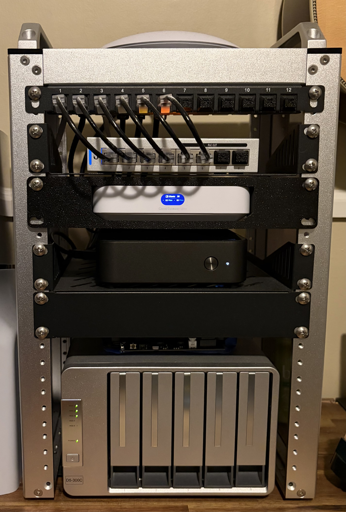
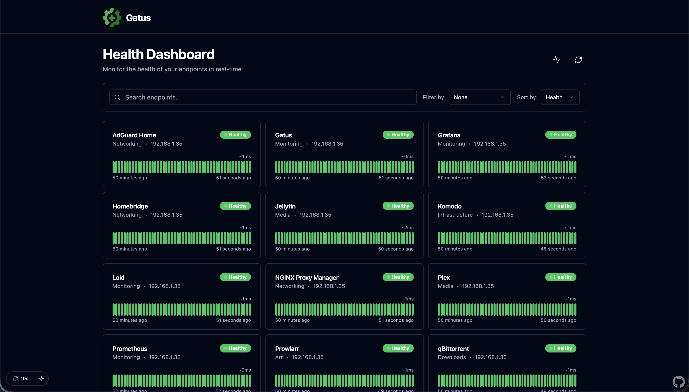

# Homelab

This is the setup behind my home network, Plex library, and ebook shelf. It all runs on one Intel N150 mini PC with Debian 13. The Compose files live here, and Komodo deploys them.

  
   
  <em>8U, 10 inches wide, and about 45 TB of usable storage.</em>

## Hardware and storage

| Component | Details |
| --- | --- |
| Rack | 8U, 10-inch open frame with a UniFi switch and Cloud Gateway |
| Server | Intel N150 mini PC, 32 GB DDR4, Debian 13 (Trixie) |
| Storage | About 45 TB usable in a direct-attached enclosure |

mergerFS pools the disks at `/mnt/nas` and places new files on the disk with the most free space. SnapRAID provides single-drive parity, and snapraid-runner runs the sync with safety thresholds.

Media and torrent data live under `/mnt/nas/data`. Most bind-mounted app configs and metadata live on the host SSD under `/opt/appdata`, including CWA’s Calibre library.

## Stacks

| Stack | Services |
| --- | --- |
| [Media](stacks/media/compose.yaml) | Plex, PlexAutoLanguages |
| [Ebooks](stacks/ebooks/compose.yaml) | Calibre-Web Automated, Shelfmark |
| [Arr](stacks/arr/compose.yaml) | Sonarr (TV and anime), Radarr, Seerr, Agregarr, Profilarr |
| [Downloads](stacks/downloads/compose.yaml) | RDTClient, Decypharr, Prowlarr, FlareSolverr |
| [Networking](stacks/networking/compose.yaml) | AdGuard Home, NGINX Proxy Manager, Homebridge |
| [Monitoring](stacks/monitoring/compose.yaml) | Prometheus, Grafana, Loki, Promtail, Gatus, cAdvisor, Node Exporter, Homepage, Unpoller |

Plex handles video, with separate Sonarr instances for TV and anime. Shelfmark writes to `/mnt/nas/data/torrents/books`, which Calibre-Web Automated mounts as its ingest directory. CWA removes the files from that directory after processing them.

## Deployments and networking

GitHub Actions lints the stack YAML, validates the Compose files, and runs a KICS scan. On pushes to `main`, a self-hosted runner calls Komodo to redeploy the changed stacks. Each stack has a `compose.yaml` under `stacks/`, and Komodo’s own Compose file lives in `komodo/`.

AdGuard Home handles local DNS, and NGINX Proxy Manager handles reverse proxying and TLS termination. NGINX Proxy Manager and selected services share the external Docker network named `proxy`. AdGuard Home, Homebridge, and several monitoring services use host networking.

Stack `.env` files are gitignored and managed on the host. The `.env.example` files document variables where provided. Host access uses SSH keys, and UFW handles the firewall.

## Monitoring

Gatus is where I check what’s up. Its HTTP checks are grouped by stack in [gatus/config.yaml](stacks/monitoring/gatus/config.yaml), and it sends failure and recovery alerts to Discord.

Prometheus is configured to scrape Node Exporter and cAdvisor every 15 seconds and Unpoller every 30 seconds. I use Grafana to check host CPU, memory, disk and network usage, as well as per-container resource usage. Grafana also sends Discord alerts for disk usage above 80%, memory usage above 85%, and container availability.

Promtail discovers containers through Docker and ships their logs to Loki. In Grafana, I can query them with LogQL and filter by container, Compose project, Compose service, or log stream.

  
  

## Roadmap

- [ ] Move secrets management to HashiCorp Vault
- [ ] Try k3s
- [ ] Evaluate Trivy, Fail2ban, and further network segmentation
