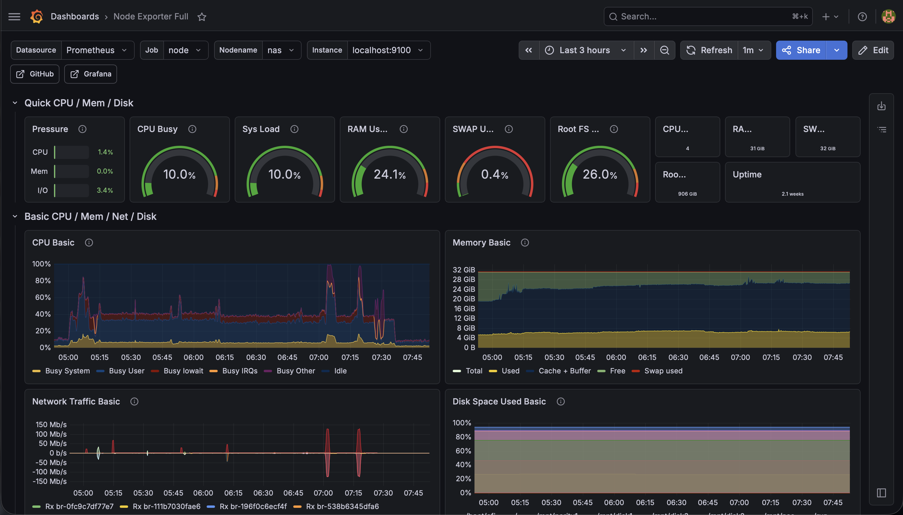

# Homelab

A single-node Debian homelab for media, ebooks, and home networking. The stacks run in Docker Compose, with deployments handled by Komodo.

  
   
  <em>8U rack with a UniFi switch, Cloud Gateway, Intel N150 mini PC, and 45 TB DAS.</em>

## Hardware

| Component | Details |
| --- | --- |
| Rack | 8U, 10-inch open frame with a UniFi switch and Cloud Gateway |
| Server | Intel N150 mini PC, 32 GB DDR4, Debian 13 (Trixie) |
| Storage | About 45 TB usable in a direct-attached enclosure |

## Stacks

| Stack | Services |
| --- | --- |
| [Media](stacks/media/compose.yaml) | Plex, PlexAutoLanguages |
| [Ebooks](stacks/ebooks/compose.yaml) | Calibre-Web Automated, Shelfmark, Audiobookshelf |
| [Arr](stacks/arr/compose.yaml) | Sonarr (TV and anime), Radarr, Seerr, Agregarr, Profilarr |
| [Downloads](stacks/downloads/compose.yaml) | RDTClient, Decypharr, Prowlarr, FlareSolverr |
| [Networking](stacks/networking/compose.yaml) | AdGuard Home, NGINX Proxy Manager, Homebridge |
| [Monitoring](stacks/monitoring/compose.yaml) | Prometheus, Grafana, Loki, Promtail, Gatus, cAdvisor, Node Exporter, Homepage, Unpoller |

## Observability

Prometheus scrapes Node Exporter and cAdvisor every 15 seconds and Unpoller every 30 seconds. Grafana shows host CPU, memory, disk and network usage alongside per-container resource usage.

Promtail uses Docker service discovery to send container logs to Loki. Grafana queries them with LogQL using labels for container name, Compose project, Compose service, and log stream.

Gatus runs HTTP checks and verifies local DNS resolution through AdGuard Home. It sends failure and recovery alerts to Discord. Grafana also alerts there on disk usage above 80%, memory usage above 85%, and container availability.

## Dashboards

| Grafana | Gatus |
| --- | --- |
|  |  |
| Grafana dashboard showing host CPU load, memory and swap usage, network traffic, and disk usage. | Service status, response times, and recent check history. |

## Infrastructure

GitHub Actions lints the stack YAML, validates the Compose files, and runs a KICS scan. On a push to `main`, a self-hosted runner asks Komodo to deploy the changed stacks and waits for the results.

AdGuard Home handles local DNS. NGINX Proxy Manager terminates TLS and reaches selected services over the shared `proxy` Docker network. AdGuard Home, Homebridge, and several monitoring services use host networking.

Host access uses SSH keys and UFW handles the firewall. Stack `.env` files are gitignored and managed on the host, with `.env.example` files as references.

## Storage

mergerFS pools the disks at `/mnt/nas` with most-free-space allocation. SnapRAID provides single-drive parity, and snapraid-runner handles syncs with safety thresholds. Media and downloads live under `/mnt/nas/data`. Most app configs and metadata live on the host SSD at `/opt/appdata`.

The [operations guide](docs/operations.md) covers host rebuilds, volume recovery, and deployment checks.

## Roadmap

- [ ] Move secrets management to HashiCorp Vault
- [ ] Try k3s
- [ ] Evaluate Trivy, Fail2ban, and further network segmentation
